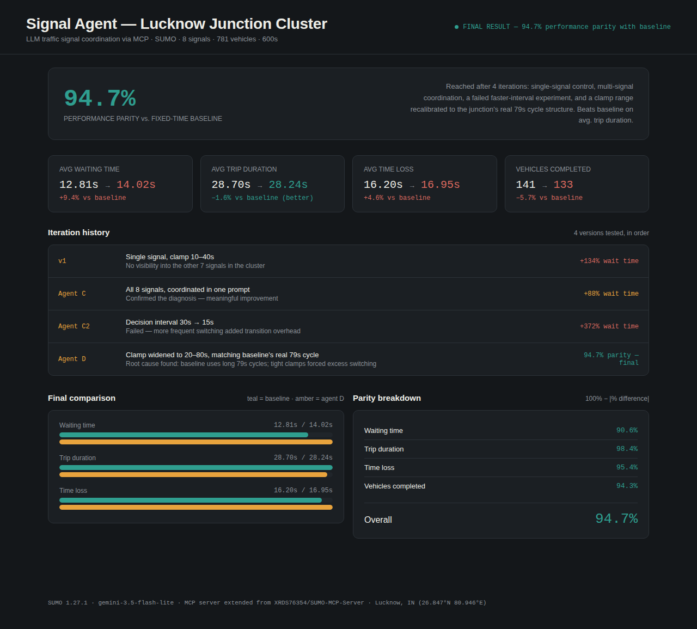
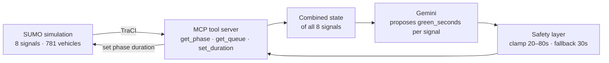

# TrafficPulse — LLM-Driven Adaptive Signal Coordination Agent

An LLM agent that coordinates **8 traffic signals** in a real Lucknow junction cluster (Hazratganj) inside the SUMO simulator. Every 30 simulated seconds it reads live queue data, asks Gemini for a green-time plan, passes every decision through a safety layer, and applies it. Results are measured against the junction's fixed-time baseline on identical Indian mixed traffic.



> Interactive version: [`results/dashboard.html`](results/dashboard.html) (open it in any browser).

## Results

Same network, same 781-vehicle demand, 600 simulated seconds. Baseline = the junction's own fixed-time plan (79s green / 6s yellow / 5s red).

| Metric | Fixed-time baseline | TrafficPulse agent | Difference |
|---|---|---|---|
| Avg. waiting time | 12.81 s | 14.02 s | +9.4% |
| Avg. trip duration | 28.70 s | **28.24 s** | **−1.6% (better)** |
| Avg. time loss | 16.20 s | 16.95 s | +4.6% |
| Vehicles completed | 141 | 133 | −5.7% |

**Overall performance parity: 94.7%** (100% − mean absolute difference across the four metrics). The agent matches the baseline within about 10% on every metric and beats it on average trip duration. It does **not** outperform the baseline overall. This is a research prototype, not a replacement for a tuned signal plan.

LLM reliability in the final run: 20/20 decision cycles, 160/160 per-signal decisions valid, 0 fallbacks.

## How it works



1. SUMO steps forward 30 seconds.
2. The agent reads queue length and waiting time for all 8 signals in one pass.
3. One combined prompt goes to Gemini, which returns a JSON array of `{tls_id, green_seconds}`.
4. Each value is validated independently: clamped to the safe range, or replaced with a fixed 30s fallback if missing, unparseable, or the API call failed.
5. Validated values are applied to the simulation. Repeat until 600s.

### Safety layer

| Situation | Behaviour |
|---|---|
| Value outside 20–80s | Clamped into range |
| Malformed or missing JSON | Fixed 30s fallback |
| API error / rate limit | Fixed 30s fallback |
| Signal missing from response | Fallback for that signal only |

Stress test: one run hit the Gemini free-tier rate limit mid-simulation. All 16 failed calls fell back safely, with zero crashes and zero invalid signal states.

## How the error was reduced

Each version was a hypothesis, measured against the same baseline.

| Version | Change | Avg. wait | vs. baseline |
|---|---|---|---|
| v1 | One signal controlled in isolation, clamp 10–40s | 29.97 s | +134% |
| Agent C | All 8 signals coordinated in one prompt | 24.13 s | +88% |
| Agent C2 | Decision interval 30s → 15s | 60.48 s | +372% |
| **Agent D** | Clamp widened to 20–80s | **14.02 s** | **+9.4%** |

- **v1 → C:** one signal had no view of its 7 neighbours. Showing all 8 queues in one prompt closed part of the gap.
- **C → C2 (failed):** deciding more often meant more phase switches, and every switch costs 11s of yellow+red. More switching, less moving traffic.
- **C2 → D:** inspecting the baseline showed 79s green phases, while the agent was clamped to 10–40s and forced into short cycles. Matching the clamp to the network's real cycle structure fixed the main problem.

## Tech stack

| Layer | Technology |
|---|---|
| Simulator | Eclipse SUMO 1.27.1 (TraCI) |
| Tool server | Model Context Protocol (Python SDK), extended from [SUMO-MCP-Server](https://github.com/XRDS76354/SUMO-MCP-Server) |
| LLM | Google Gemini (`gemini-3.5-flash-lite`) via `google-genai` |
| Map data | OpenStreetMap (Hazratganj, Lucknow), converted with `netconvert` |
| Demand | SUMO `randomTrips.py` + `duarouter` (motorcycles, cars, buses) |
| Dashboard | Single-file HTML/CSS |

## Repository structure

```
├── src/
│   ├── server.py                  # MCP server (original repo + manage_traffic_lights tool)
│   └── mcp_tools/
│       └── traffic_light.py       # NEW: get_tls_ids, get_phase, get_queue_lengths, set_phase_duration
├── agent/
│   ├── agent_loop.py              # NEW: multi-signal decision loop
│   ├── prompts.py                 # NEW: system prompt + state formatting
│   └── safety.py                  # NEW: clamping and fallback
├── scenario/                      # NEW: Lucknow network, routes, SUMO configs
├── results/
│   └── dashboard.html             # interactive results dashboard
├── docs/
│   └── dashboard.png              # screenshot used above
└── README.md
```

## Getting started

**Prerequisites:** [Eclipse SUMO](https://sumo.dlr.de/docs/Downloads.php) with `SUMO_HOME` set and `sumo` on your PATH, Python 3.10–3.12, and a free [Gemini API key](https://aistudio.google.com/apikey).

```bash
git clone https://github.com/<your-username>/<repo-name>.git
cd <repo-name>

python -m venv .venv
source .venv/Scripts/activate      # Windows Git Bash; use .venv/bin/activate on Linux/macOS
pip install -r requirements.txt
pip install "mcp<2" google-genai   # mcp 2.x renamed FastMCP and breaks this server

export GEMINI_API_KEY="your-key"   # keep this out of the repo
```

**Run the fixed-time baseline:**

```bash
sumo -c scenario/config.sumocfg
```

**Run the agent** (about 5 minutes, since calls are spaced 13s apart to respect the free-tier limit):

```bash
python -m agent.agent_loop --config scenario/config_agent_d.sumocfg --steps 600 --output agent/agent_decisions_d.csv
```

**Compute metrics** from SUMO's output:

```bash
python -c "
import xml.etree.ElementTree as ET
t = ET.parse('scenario/agent_d_tripinfo.xml').getroot().findall('tripinfo')
n = len(t)
print('vehicles', n)
print('avg wait', sum(float(x.get('waitingTime')) for x in t)/n)
print('avg duration', sum(float(x.get('duration')) for x in t)/n)
print('avg time loss', sum(float(x.get('timeLoss')) for x in t)/n)
"
```

### Rebuilding the scenario (optional)

```bash
python "$SUMO_HOME/tools/osmGet.py" --bbox 80.9452270,26.8462410,80.9472840,26.8471040 --output-prefix map
netconvert --osm-files map_bbox.osm.xml -o junction.net.xml \
  --tls.guess-signals true --sidewalks.guess true --crossings.guess true \
  --geometry.remove true --roundabouts.guess true
python "$SUMO_HOME/tools/randomTrips.py" -n junction.net.xml -o trips_moto.trips.xml --vehicle-class motorcycle --prefix moto -p 1.2 -e 600 --validate
python "$SUMO_HOME/tools/randomTrips.py" -n junction.net.xml -o trips_car.trips.xml  --vehicle-class passenger  --prefix car  -p 2.5 -e 600 --validate
python "$SUMO_HOME/tools/randomTrips.py" -n junction.net.xml -o trips_bus.trips.xml  --vehicle-class bus        --prefix bus  -p 15  -e 600 --validate
duarouter -n junction.net.xml -r trips_moto.trips.xml,trips_car.trips.xml,trips_bus.trips.xml -o routes.rou.xml --ignore-errors
```

## Data

| Data | Source | Size |
|---|---|---|
| Road network | Real OpenStreetMap export, ~150m × 100m around Hazratganj | a few hundred KB |
| Traffic demand | Generated with `randomTrips.py`, motorcycle-heavy mix, 781 trips | ~150 KB |
| Simulation output | SUMO `tripinfo.xml` per run | ~60 KB per run |

This is a simulation evaluation, not a trained model. There is no training set, and the LLM is not fine-tuned.

## Limitations

- **Simulation only.** Real deployment would need physical sensors or cameras, offline or local inference, and traffic-authority approval and safety certification.
- **One junction cluster.** The 20–80s clamp was derived from this network's 79s baseline cycle. A new junction needs its own calibration.
- **MCP usage.** The MCP tool server is built and tested, but `agent_loop.py` currently calls the same tool functions directly rather than as an MCP client over the protocol.
- **No spatial awareness.** The LLM sees queue numbers for each signal, not distances or travel times between them, so it cannot plan true green-wave coordination.
- **Small sample.** One run of 20 decision cycles per version. Multiple seeds would be needed for confidence intervals.
- **Does not beat the baseline overall.** Parity, not improvement, is the honest summary.

## Future work

- Route the agent through a real MCP client session
- Add inter-signal distance and travel-time context to the prompt
- Evaluate over multiple random seeds and on other junctions (Indore, Bhopal)
- Live dashboard that streams decisions while the simulation runs
- Local open-source LLM to remove the internet dependency

## Credits and license

Built on the open-source [SUMO-MCP-Server](https://github.com/XRDS76354/SUMO-MCP-Server) by XRDS76354 (MIT). Traffic simulation by [Eclipse SUMO](https://sumo.dlr.de/). Map data © OpenStreetMap contributors. See `LICENSE`.
